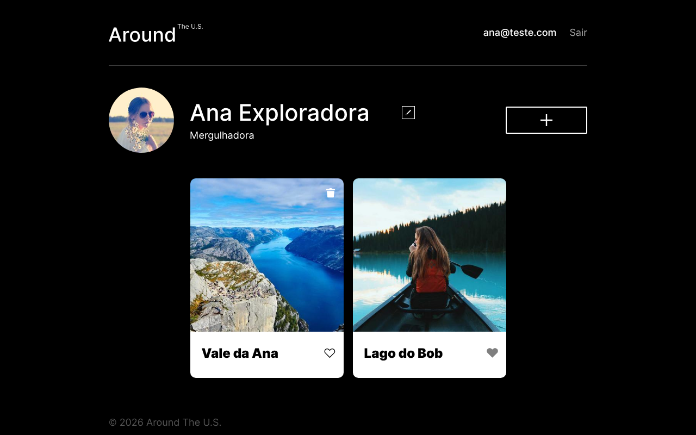

# 🌎 Around The U.S. — aplicativo completo (front-end + API)

> 🎬 **Vídeo de demonstração (2,5 min):** https://drive.google.com/file/d/1PKVJLZ9IMhmqFkeKVeBmxXHoK42Sd21O/view · 🌐 **Site:** https://leoaround.kaiak.top

## 📅 Sprints

Projeto da **Sprint 18**, a última do curso de Desenvolvimento Web da
TripleTen Brasil. Este repositório junta, numa versão nova, dois projetos
anteriores:

- `backend/` — a API dos Projetos 15 e 16
  ([`web_project_around_express`](https://github.com/oleodias/web_project_around_express),
  Sprints 15 e 16);
- `frontend/` — o app React do Projeto 17
  ([`web_project_around_auth`](https://github.com/oleodias/web_project_around_auth),
  Sprint 17), que por sua vez veio dos Projetos 13 e 14.

| Sprint | O que foi feito neste repositório |
| --- | --- |
| 18 | Cadastro e login na API própria (bcrypt + JWT), rotas protegidas, erros centralizados, validação com celebrate, logs, CORS; o front passa a usar só esta API; implantação com domínio e HTTPS |

## 🔗 Endereços

- **Aplicativo:** <https://leoaround.kaiak.top> (também `https://www.leoaround.kaiak.top` e por HTTP)
- **API:** <https://api.leoaround.kaiak.top> (também por HTTP)

Servidor: VM no Google Cloud (Ubuntu 22.04), NGINX como proxy reverso,
certificado Let's Encrypt para os três nomes, API mantida pelo PM2.

## 🎬 Demonstração em vídeo

> 🔗 **Vídeo:** [assistir no Google Drive](https://drive.google.com/file/d/1PKVJLZ9IMhmqFkeKVeBmxXHoK42Sd21O/view?usp=sharing)

Vídeo de **2min28** (1080p, 60 fps, legendas em português). O primeiro
capítulo mostra o app e a API **em produção** (só leitura); os outros mostram o
código deste repositório, **sem alterações**, rodando localmente com um
**MongoDB real**, com duas contas de teste.

| Capítulo | O que aparece | Onde está no código |
| --- | --- | --- |
| 01 · No ar | o app em `leoaround.kaiak.top` e a API respondendo 401 sem token | `middlewares/auth.js`, NGINX + PM2 |
| 02 · Cadastro | `POST /signup` → 201 e o documento no MongoDB com a senha em hash bcrypt | `controllers/users.js` (`createUser`) |
| 03 · E-mail repetido | o mesmo e-mail de novo → 409 | índice `unique` em `models/user.js` → erro 11000 → 409 no `error-handler.js` |
| 04 · Login | `POST /signin` → JWT de 7 dias, salvo no navegador | `login`, `utils/config.js` |
| 05 · Novo cartão | `POST /cards` → 201; a lixeira só para a dona | `owner` vindo de `req.user` |
| 06 · Outra conta | outra pessoa vê o cartão sem lixeira, curte, e excluir pela API dá 403 | `deleteCard` com `ForbiddenError` |
| 07 · Logs | as linhas do `request.log` (método, rota, status e tempo) | `middlewares/logger.js` (winston) |
| 08 · Sair | o token é apagado e o app volta ao login | `handleSignOut` no front |

**Como o vídeo foi feito:** a tela é uma gravação real do navegador
(Playwright). As janelas de terminal mostram saídas reais (MongoDB, `curl` e
`request.log`) numa janela desenhada pelo vídeo. Por cima há só uma camada de
_motion_ (câmera, cursor, setas, destaques, legendas e capítulos), feita com
Python, Cairo e ffmpeg. Senhas, tokens e o hash completo nunca aparecem.

**Trilha sonora:** original, composta e sintetizada por código para o vídeo
(sem samples nem músicas de terceiros), sincronizada com as animações.

### Resumo

- **O que foi construído e por quê:** o front-end React do curso ligado a uma
  API própria (Express 5 + MongoDB), com cadastro e login seguros, validação,
  erros centralizados e logs, publicada num servidor real para funcionar de
  ponta a ponta na internet.
- **Problema que resolve:** cada pessoa tem a sua conta e só mexe no que é seu
  (403), e-mails repetidos são barrados (409), rotas sem token respondem 401, e
  o app fica no ar com domínio próprio e HTTPS.
- **Tecnologias:** Node.js, Express 5, MongoDB/Mongoose, bcryptjs, JWT,
  celebrate, winston, React 19, React Router 6, Vite, Google Cloud, NGINX, PM2
  e Let's Encrypt.

## 🚩 O que o aplicativo faz

Uma galeria de fotos de lugares. Cada pessoa cria a sua conta, entra, edita o
próprio perfil e avatar, publica cartões, curte os de todos e exclui só os
seus.



- **Cadastro e login** com e-mail e senha. A senha é guardada como hash
  (bcrypt); o login devolve um JWT válido por 7 dias.
- **Todas as rotas exigem o token**, exceto `/signup` e `/signin`.
- **Cada um mexe só no que é seu:** o perfil editado é sempre o do dono do
  token; excluir o cartão de outra pessoa responde 403.
- **Erros num formato só**, `{ message }`, com o status certo.

## 🧩 A API

| Método | Rota | Corpo | Resposta |
| --- | --- | --- | --- |
| POST | `/signup` | `email`, `password` (+ `name`, `about`, `avatar` opcionais) | 201, o usuário sem a senha |
| POST | `/signin` | `email`, `password` | `{ token }` |
| GET | `/users/me` | — | o usuário do token |
| GET | `/users` · `/users/:userId` | — | usuários |
| PATCH | `/users/me` | `name`, `about` | o usuário atualizado |
| PATCH | `/users/me/avatar` | `avatar` | o usuário atualizado |
| GET | `/cards` | — | cartões, do mais novo ao mais antigo |
| POST | `/cards` | `name`, `link` | 201, o cartão |
| DELETE | `/cards/:cardId` | — | o cartão excluído (403 se não for seu) |
| PUT · DELETE | `/cards/:cardId/likes` | — | o cartão com `likes` atualizado |

Rotas protegidas: cabeçalho `Authorization: Bearer <token>`.

| Status | Quando |
| --- | --- |
| 400 | dados inválidos (celebrate ou Mongoose), id malformado, JSON malformado |
| 401 | sem token, token inválido ou vencido, e-mail ou senha incorretos |
| 403 | excluir o cartão de outra pessoa |
| 404 | usuário, cartão ou rota inexistente |
| 409 | e-mail já cadastrado |
| 500 | qualquer outro erro: "Ocorreu um erro no servidor" |

## 🛠️ Tecnologias e técnicas

**Back-end:** Node.js, Express 5, MongoDB com Mongoose 8, bcryptjs,
jsonwebtoken, celebrate/Joi, validator, winston + express-winston (logs em
JSON), cors, dotenv, ESLint (Airbnb).

**Front-end:** React 19, React Router 6, Vite, Context API, CSS com BEM Flat,
oxlint e Prettier.

**Servidor:** VM no Google Cloud (Ubuntu 22.04), PM2, NGINX como proxy
reverso, FreeDNS, HTTPS com Certbot (Let's Encrypt).

Algumas decisões:

- **`password` com `select: false`**: as buscas não trazem o hash; só o
  login pede, com `.select('+password')`. O `create()` não respeita o
  `select`, por isso o cadastro monta a resposta campo a campo.
- **Um tratador de erros só** (`middlewares/error-handler.js`), que também
  trata os erros do celebrate. O `errors()` do celebrate responderia num
  formato próprio, com mais campos além de `message`.
- **`validator.isURL` com `require_protocol`**: concorda com o esquema do
  Mongoose, que exige `http(s)://`.
- **`app.use(cors())` sem o `app.options('*', ...)`**: no Express 5, o `'*'`
  sozinho derruba o servidor, e o `app.use(cors())` já responde ao preflight.
- **Chave do JWT** em `utils/config.js`, usada pelo login e pelo middleware:
  `JWT_SECRET` do `.env` em produção; uma chave de desenvolvimento fora dela,
  para o projeto rodar sem o `.env`.

## 💻 Como executar localmente

Precisa do Node.js e do MongoDB rodando em `localhost:27017`.

```bash
# terminal 1 — API em http://localhost:3000
cd backend
npm install
npm run dev

# terminal 2 — front em http://localhost:5173
cd frontend
npm install
npm run dev
```

Sem `.env`, a API usa a chave de desenvolvimento e o front fala com
`http://localhost:3000`.

## 🚀 Implantação

O passo a passo do servidor (VM, PM2, domínio, NGINX, HTTPS e o build do
front) está em [`docs/IMPLANTACAO.md`](docs/IMPLANTACAO.md).

---

**Leonardo Dias Caumo** — _Desenvolvido como parte do portfólio de estudos em Desenvolvimento Web da TripleTen Brasil._
